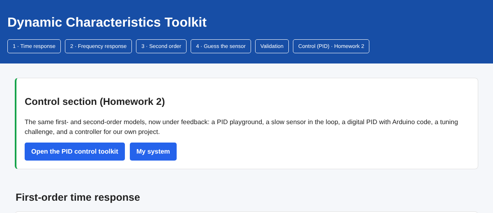
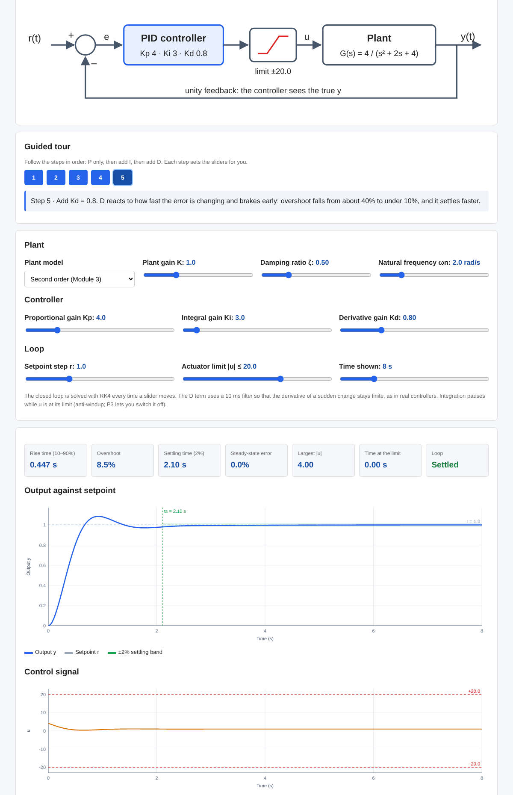
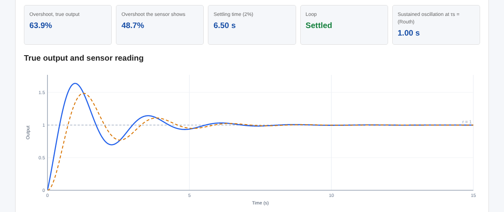
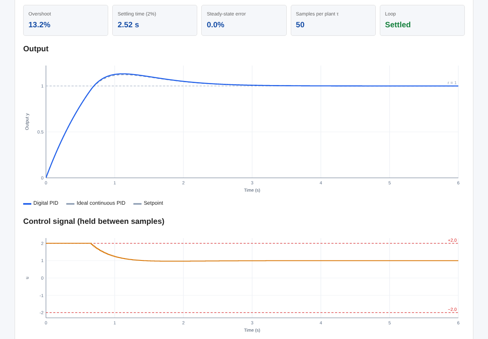
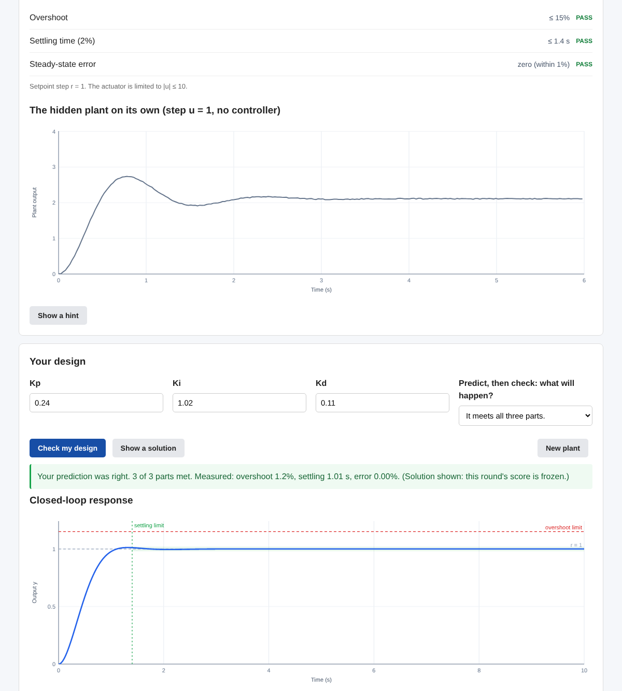
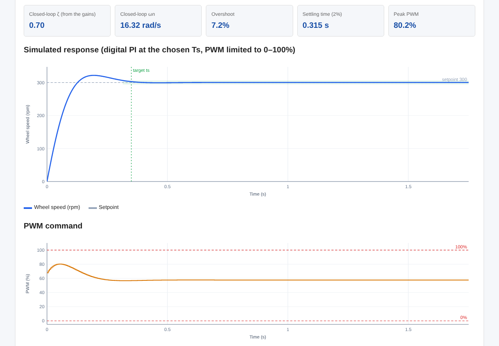
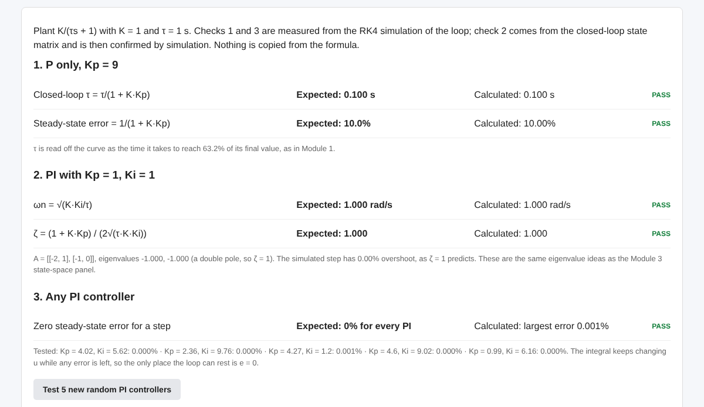

# ENCS4380 – Dynamic Characteristics & PID Control Toolkit

Interactive toolkit for ENCS4380 Interfacing Techniques, Birzeit University (instructor: Dr. Wasel Ghanem).

Homework 1 shows how slow a sensor is; Homework 2 puts the same models under feedback control.

**Live site:** https://tareqziad2005.github.io/encs4380-dynamics-36/

- Homework 1 toolkit: [index.html](https://tareqziad2005.github.io/encs4380-dynamics-36/)
- Homework 2 control section: [control.html](https://tareqziad2005.github.io/encs4380-dynamics-36/control.html)
- Our own system: [mysystem.html](https://tareqziad2005.github.io/encs4380-dynamics-36/mysystem.html)

Everything runs in the browser. No server, no login, no external libraries.

## Team

| Member | ID |
| Tareq Darawshih | 1230260 |
| Oghaid Mashaqi | 1231100 |
| Abd Al-Rahman Khanfar | 1231348 |
| Bahaa Al Sarissi | 1231149 |

## Homework 2 – PID Control (v2.0)

| Module | Files | Owner | GitHub Issue |
| P1 · PID Playground | `p1.js`, P1 section of `control.html` | Tareq Darawshih | TBD |
| P2 · A Slow Sensor in the Loop | `p2.js` | Oghaid Mashaqi | TBD |
| P3 · Digital PID + Arduino Code | `p3.js` | Abd Al-Rahman Khanfar | TBD |
| P4 · Tuning Challenge | `p4.js` | Bahaa Al Sarissi | TBD |
| Shared Engine (RK4, metrics, plots) | `pid-core.js` | All members | — |
| Validation Checks | `validation2.js` | All members | — |
| My System | `mysystem.html`, `mysystem.js` | All members | — |

### What Each Module Does

**P1 · PID Playground**

A first-order (Module 1) or second-order (Module 3) plant with sliders for Kp, Ki, Kd, setpoint, and actuator limit. Shows the block diagram, output against setpoint, control signal with its limit, and live rise time, overshoot, settling time, and steady-state error. A five-step guided tour demonstrates P → PI → PID.

**P2 · A Slow Sensor in the Loop**

A first-order sensor 1/(τs·s + 1) in the feedback path. The true output and sensor reading are plotted together. A sweep plots overshoot against τs, and the Routh test gives the τs at which the loop oscillates:

τs = (1 + Kd)(1 + Kp)/(Ki − 1 − Kp).

**P3 · Digital PID**

Implements the digital PID equation:

u[k] = Kp·e[k] + Ki·Ts·Σe[j] + Kd·(e[k] − e[k−1])/Ts

The controller runs once per sample with a zero-order hold and is compared with the ideal continuous controller. Shows the stair-step control signal, overshoot against Ts, an anti-windup switch, and Arduino code for the current gains with a copy button.

The simulation and generated Arduino code use the same controller logic.

**P4 · Tuning Challenge**

A hidden random plant (reusing Homework 1's Module 4 "Guess the Sensor") with a specification including an overshoot limit, settling-time limit, and zero steady-state error.

Before showing a specification, the page searches a grid of gains to make sure the specification is achievable. It provides pass or fail results for each requirement, a prediction before each check, and a session score.

**My System · Micromouse Motor Model**

A first-order illustrative model representing our planned Micromouse drive motor. The page includes:

- A step-test fitter using the 63.2% point and logarithmic fitting method from Module 1.
- PI controller design based on damping ratio ζ and settling time.
- A simulated digital control loop with PWM limited to 0–100%.
- Generated Arduino controller code.

**Hardware limitation:** The physical Micromouse hardware and encoder motors were not available before the submission deadline. Therefore, the current parameters (K = 5.2 and τ = 0.09 s) are illustrative examples and have not been experimentally measured or validated.

The page demonstrates the measurement and controller-design procedure. A real PWM step test using the motor encoder is planned once the hardware becomes available. The measured parameters will then replace the illustrative values.

The generated Arduino sketch provides the controller logic. Encoder reading and hardware-specific pin configuration must be completed when the physical robot is assembled.

### Validation Checks (Plant 1/(s + 1))

| Check | Expected | How the Page Gets Its Value |
|---|---|---|
| P only, Kp = 9: closed-loop τ | 0.1 s | Time to 63.2% on the simulated curve |
| P only, Kp = 9: steady-state error | 10% | Final value of the simulated curve |
| PI, Kp = Ki = 1: ωn, ζ | 1 rad/s, 1 | Eigenvalues of the closed-loop state matrix, confirmed by simulation |
| Any PI: steady-state error | 0 | Five random PI controllers simulated to steady state |

### How the Simulation Works

- `simulateContinuous()` steps the whole loop (plant, sensor, integral, derivative filter) with RK4. The step size shrinks automatically when a large Kd on a fast plant would make RK4 unstable.
- The D term uses a 10 ms filter, (e − xf)/Tf ≈ de/dt, so the derivative of a sudden change stays finite.
- Anti-windup uses conditional integration: the integral sum is prevented from growing further when the control signal is saturated and the error would push it further into saturation.
- `simulateDigital()` runs the controller once per Ts and integrates the plant between samples with RK4 sub-steps.

## Homework 1 – Dynamic Characteristics (v1.0)

1. **First-order time response:** Step and ramp, 63.2% and 95% markers, ramp lag, and logarithmic error-fraction plot.
2. **First-order frequency response:** Input and output sinusoids, amplitude ratio, phase lag, Bode plot, and dynamic error.
3. **Second-order response:** Damping cases, rise/peak/settling time, overshoot, poles, state-space panel with eigenvalues, and phase plane.
4. **Guess the Sensor:** Estimate τ, or ζ and ωn, from a noisy response.

Tareq Darawshih led the HTML structure, inputs, equations, and calculations across the four modules. All members contributed to implementation, testing, and fixes.

## Use of AI Tools

- **Homework 1:** ChatGPT helped with canvas plotting and debugging.
- **Homework 2:** Claude (Anthropic) helped draft the simulation engine, module pages, and Arduino code generator. The team reviewed and tested the code, checked the validation numbers, and can explain the equations and implementation during the demonstration.

## Running Locally

Clone the repository and open `index.html` in a browser.

Nothing to install.

## Deployment

The project is deployed using GitHub Pages through GitHub Actions.

The workflow deploys the repository root, allowing the Homework 1 toolkit, Homework 2 control modules, and My System page to be available through the same website.

Final release: **v2.0**